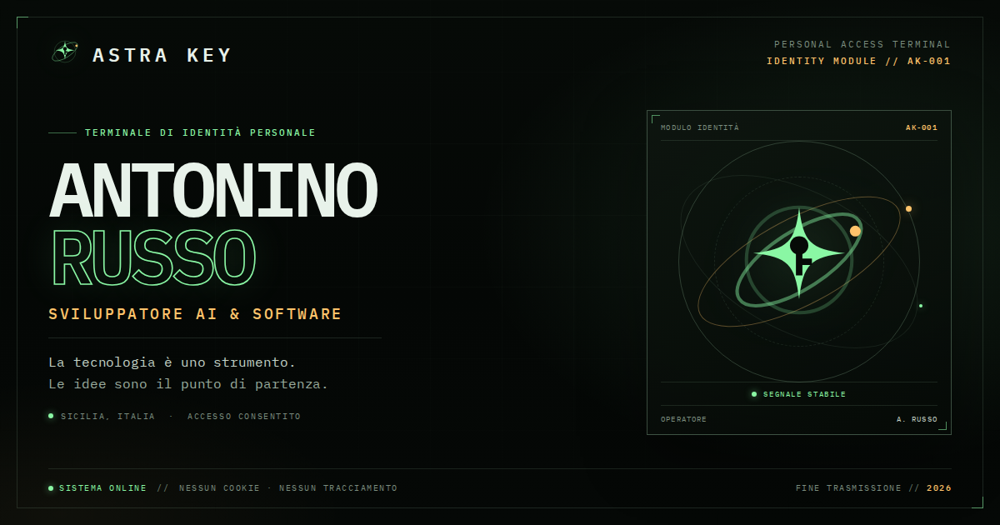

# ASTRA KEY

Personal identity terminal for **Antonino Russo** — AI & Software Developer.

ASTRA KEY is a single-page personal site built as a fictional 1990s access terminal: a short boot sequence, a phosphor-green identity plate, a bilingual profile, five direct contact channels, and an interactive local shell. It is a fully static frontend — no backend, accounts, cookies, analytics, or tracking.



## Features

- **Terminal art direction** — near-black CRT surface, phosphor green and amber accents, scanlines, glow, orbital identity plate, self-hosted IBM Plex Mono.
- **Boot sequence** — `ASTRA KEY BIOS`, `PERSONAL ACCESS TERMINAL`, `INITIALIZING PROFILE`, `CONNECTION ESTABLISHED`; it can be skipped, runs once per session, and is bypassed when reduced motion is requested.
- **Italian and English** — Italian is the default. The switch updates every label, profile paragraph, contact hint, terminal response, page title, metadata, and `<html lang>` without reloading. The choice is stored in `localStorage`.
- **Direct contact** — WhatsApp (primary), phone, LinkedIn, email, and GitHub. External links use `target="_blank"` with `rel="noopener noreferrer"`.
- **Interactive terminal** — `help`, `about`, `connect`, and `astra`, available by typing or via clickable shortcuts. Command history supports the arrow keys, and past responses retranslate when the language changes.
- **Accessible and responsive** — semantic landmarks, visible focus states, keyboard-friendly interface, skip link, live regions, 24px minimum targets, reduced-motion support, and no horizontal overflow from 320px upward.
- **Static and private** — no contact forms, API calls, tracking scripts, or third-party runtime requests. Fonts are bundled at build time.

## Tech stack

- React 19 + TypeScript
- Vite 8
- Lucide React icons
- Custom inline SVG brand icons and identity mark
- Plain CSS with custom properties
- `@fontsource/ibm-plex-mono` (self-hosted latin subsets, weights 400/500/600)

## Requirements

- Node.js **20.19+** (Node 22 LTS recommended)
- npm 10+

## Local development

```bash
npm install
npm run dev
```

Open the URL printed by Vite (normally `http://localhost:5173`).

## Production build

```bash
npm run build
npm run preview
```

`npm run build` runs the TypeScript project build first and then Vite. The production output is written to `dist/`. The default base path is `/`; the GitHub Pages workflow overrides it with `VITE_BASE_PATH` so the site works correctly under `/astra_key/`.

Other useful commands:

```bash
npm run typecheck   # TypeScript only
npm run preview     # serve the production build locally
```

## Deployment

### GitHub Pages

The site is published from `main` by [`.github/workflows/deploy-pages.yml`](.github/workflows/deploy-pages.yml).

- **Live site:** https://jdt0ny.github.io/astra_key/
- **Pages source:** GitHub Actions
- **Build command:** `npm run build`
- **Output:** `dist`
- **Base path:** supplied by `actions/configure-pages` (currently `/astra_key/`)

The workflow runs on every push to `main` and can also be started manually from **Actions → Deploy to GitHub Pages → Run workflow**. It installs with `npm ci`, builds with the repository base path, uploads the Pages artifact, and deploys it.

To reproduce the setup on another repository:

1. Open **Settings → Pages → Build and deployment** and set **Source** to **GitHub Actions**.
2. Push to `main` or run the workflow manually.
3. If the repository name or custom domain changes, update the canonical, Open Graph, sitemap, robots, and profile URL values listed below.

To preview the same subpath build locally:

```bash
VITE_BASE_PATH=/astra_key/ npm run build
npm run preview
# http://localhost:4173/astra_key/
```

### Cloudflare Pages (alternative)

The build also works on Cloudflare Pages without a subpath. **No Cloudflare deployment is configured by this repository.**

1. In the Cloudflare dashboard, open **Workers & Pages → Create → Pages → Connect to Git**.
2. Select the repository.
3. Use:
   - **Framework preset:** Vite
   - **Build command:** `npm run build`
   - **Build output directory:** `dist`
   - **Node version:** set `NODE_VERSION` to `22` (or another version that satisfies `>=20.19.0`)
4. Deploy.

The site is a single HTML entry point with anchor navigation, so no SPA rewrite rule is required. `public/_headers` is copied into the build and applies security and cache headers on Cloudflare Pages.

Direct upload with Wrangler:

```bash
npm run build
npx wrangler pages deploy dist
```

### Changing the deployed domain

The canonical URL, Open Graph image, sitemap, robots file, JSON-LD, and profile website currently use `https://jdt0ny.github.io/astra_key/`. If you move to a custom domain, update:

- `index.html` — canonical, `og:url`, `og:image`, `twitter:image`, JSON-LD `url`
- `public/sitemap.xml`
- `public/robots.txt`
- `src/data/profile.ts` — `website` value
- `vite.config.ts` / `VITE_BASE_PATH` — only if the site moves from a subpath to a root domain

Then rebuild and redeploy.

## Customization

### Contact channels

Edit `src/data/contacts.ts`. Each channel has an `href`, a visible `display` value, and a shorter `terminalValue`. Labels and hints live in `src/i18n/translations.ts` under `connect.labels`.

### Bilingual copy

All interface copy, profile text, metadata, and terminal responses are in `src/i18n/translations.ts`, typed by the `Translation` interface. Add or update both the `it` and `en` records to keep the languages in sync.

### Terminal

Commands are defined in `src/data/commands.ts`; responses and announcements are in `translations.ts`. The shell accepts lowercase or uppercase input and keeps a 30-command in-memory history.

### Visual system

- `src/styles/global.css` — tokens, reset, typography, shared components, CRT overlay, responsive foundations
- `src/components/*.css` — component-level styles
- `src/components/AstraMark.tsx` — orbital key mark
- `public/favicon.svg` — favicon
- `public/og-image.png` — 1200×630 social preview
- `public/apple-touch-icon.png` — 180×180 touch icon

## Project structure

```text
.
├── .github/workflows/deploy-pages.yml
├── index.html
├── public/
│   ├── _headers
│   ├── apple-touch-icon.png
│   ├── favicon.svg
│   ├── og-image.png
│   ├── robots.txt
│   └── sitemap.xml
├── src/
│   ├── components/       # layout, sections, boot screen, terminal, icons
│   ├── data/             # contacts, commands, profile constants
│   ├── hooks/            # active section tracking
│   ├── i18n/             # typed IT/EN translations and provider
│   ├── styles/           # global design system
│   ├── App.tsx
│   └── main.tsx
├── LICENSE
└── package.json
```

## Accessibility notes

- Skip link targets the main landmark.
- The boot screen is a modal dialog: focus is moved to **Skip**, contained there, and restored to the main content afterward. The rest of the page is `inert` and `aria-hidden` while booting.
- Active navigation uses `aria-current="location"`; the terminal log is a labelled region with a polite live announcement after each command.
- The interaction is fully keyboard operable, focus outlines are amber and visible, and the terminal input is 16px on mobile to avoid browser zoom.
- Animations are suppressed under `prefers-reduced-motion: reduce`, and the initial boot is skipped entirely in that mode.
- The interface was audited with axe-core against WCAG 2.0/2.1/2.2 A/AA and best-practice rules at desktop, tablet, and mobile widths.

## Privacy

The site stores only two local preferences: `astra-key:language` (selected language) and `astra-key:booted` (session-scoped boot flag). There are no cookies, analytics, remote fonts, or outgoing data requests. The terminal runs entirely in the browser.

## License

[MIT](LICENSE) © 2026 Antonino Russo

IBM Plex Mono is licensed under the SIL Open Font License 1.1. The license text is included at [`public/fonts/LICENSE-ibm-plex-mono.txt`](public/fonts/LICENSE-ibm-plex-mono.txt).
